<p>
<picture>
  <source media="(prefers-color-scheme: light)" srcset="assets/banner/hero-v2-light.svg">
  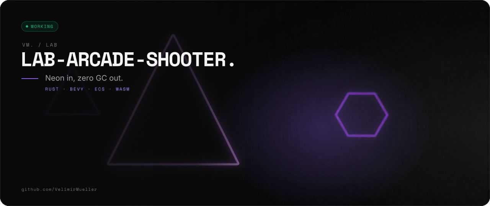
</picture>
</p>

<p>
<picture>
  <source media="(prefers-color-scheme: light)" srcset="assets/readme/lead-v2-light.svg">
  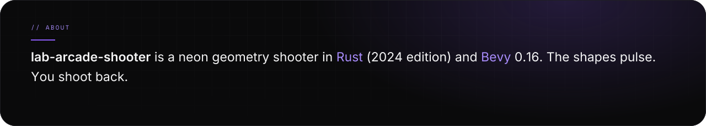
</picture>
</p>

<p>
<picture>
  <source media="(prefers-color-scheme: light)" srcset="assets/readme/stats-v2-light.svg">
  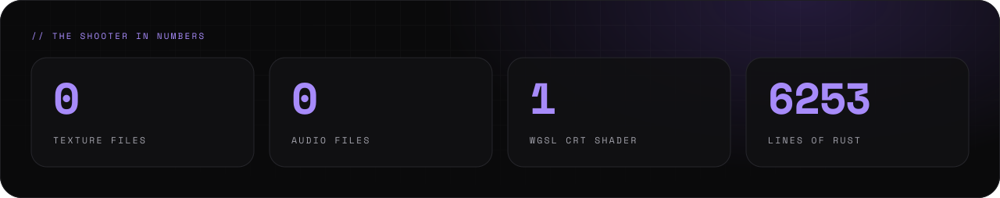
</picture>
</p>

<br>

<p>
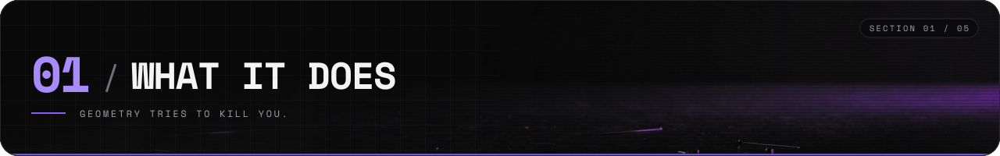
</p>

<p>
<picture>
  <source media="(prefers-color-scheme: light)" srcset="assets/readme/features-v2-light.svg">
  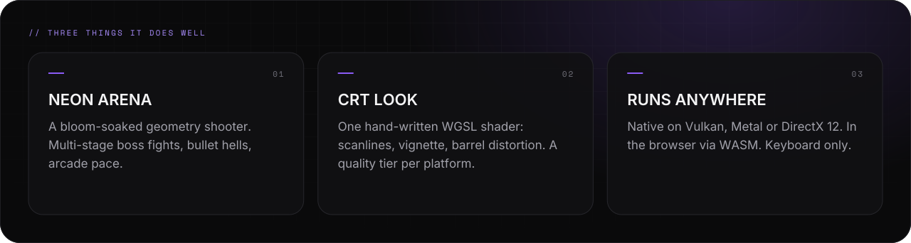
</picture>
</p>

<p>
<picture>
  <source media="(prefers-color-scheme: light)" srcset="assets/readme/what-v2-light.svg">
  
</picture>
</p>

<br>

<p>
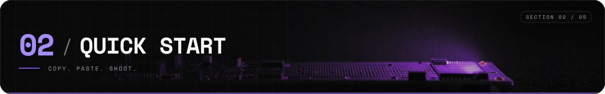
</p>

<p>
<picture>
  <source media="(prefers-color-scheme: light)" srcset="assets/readme/needs-v2-light.svg">
  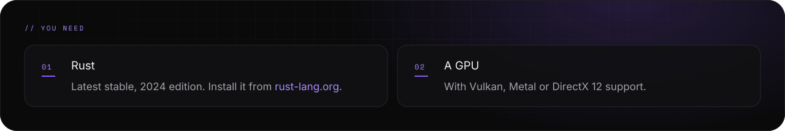
</picture>
</p>

<p>
<picture>
  <source media="(prefers-color-scheme: light)" srcset="assets/readme/start-v2-light.svg">
  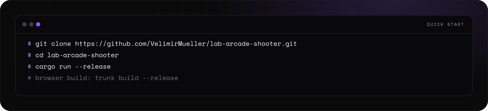
</picture>
</p>

<p>
<picture>
  <source media="(prefers-color-scheme: light)" srcset="assets/readme/wasm-v2-light.svg">
  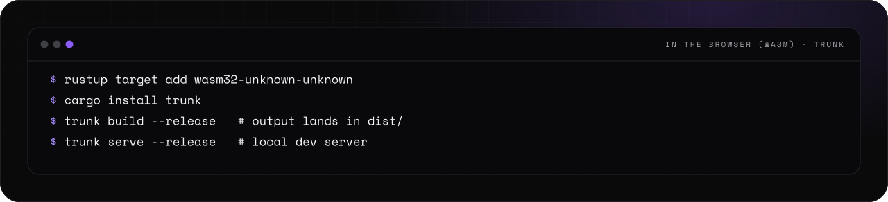
</picture>
</p>

<details>
<summary><picture><source media="(prefers-color-scheme: light)" srcset="assets/readme/links-7-v2-light.svg">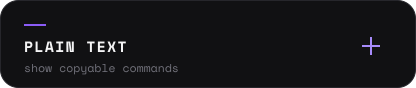</picture></summary>

```bash
git clone https://github.com/VelimirMueller/lab-arcade-shooter.git
cd lab-arcade-shooter
cargo run --release
```

```bash
rustup target add wasm32-unknown-unknown
cargo install trunk
trunk build --release   # output lands in dist/
trunk serve --release   # local dev server
```

</details>

<p>
<picture>
  <source media="(prefers-color-scheme: light)" srcset="assets/readme/web-v2-light.svg">
  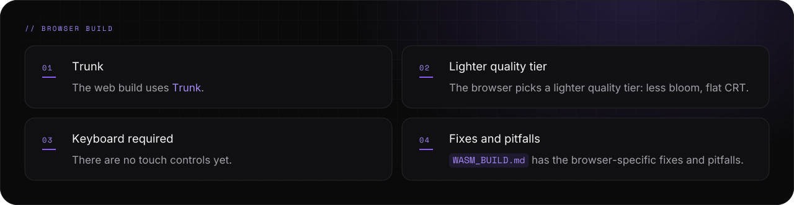
</picture>
</p>

<p align="center">
<a href="https://www.rust-lang.org/tools/install"><picture><source media="(prefers-color-scheme: light)" srcset="assets/readme/links-1-v2-light.svg">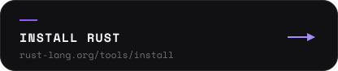</picture></a>
<a href="https://trunkrs.dev/"><picture><source media="(prefers-color-scheme: light)" srcset="assets/readme/links-2-v2-light.svg">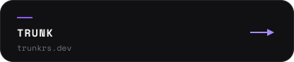</picture></a>
<a href="WASM_BUILD.md"><picture><source media="(prefers-color-scheme: light)" srcset="assets/readme/links-3-v2-light.svg">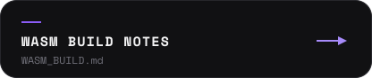</picture></a>
</p>

<br>

<p>
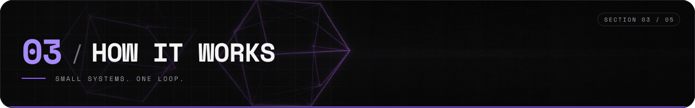
</p>

<p>
<picture>
  <source media="(prefers-color-scheme: light)" srcset="assets/readme/flow-v2-light.svg">
  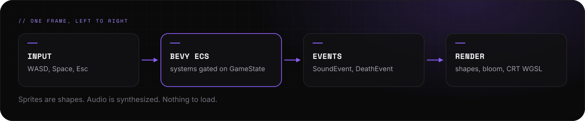
</picture>
</p>

<p>
<picture>
  <source media="(prefers-color-scheme: light)" srcset="assets/readme/systems-v2-light.svg">
  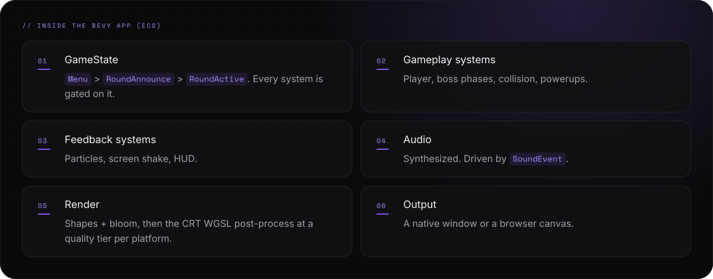
</picture>
</p>

<p>
<picture>
  <source media="(prefers-color-scheme: light)" srcset="assets/readme/how-v2-light.svg">
  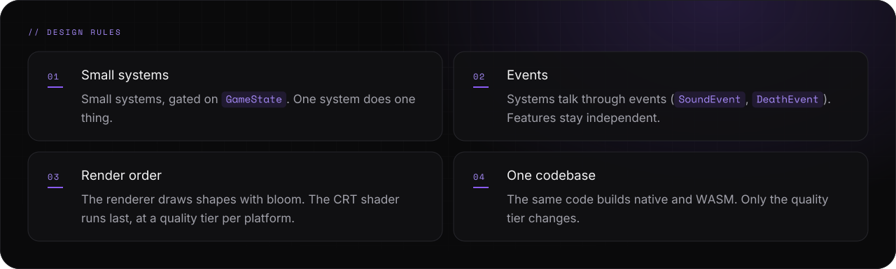
</picture>
</p>

<br>

<p>
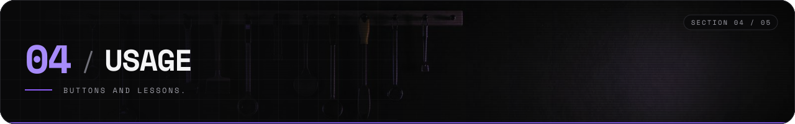
</p>

<p>
<picture>
  <source media="(prefers-color-scheme: light)" srcset="assets/readme/controls-v2-light.svg">
  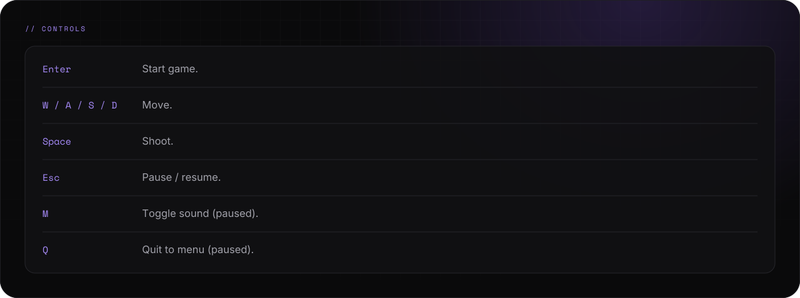
</picture>
</p>

<p>
<picture>
  <source media="(prefers-color-scheme: light)" srcset="assets/readme/platforms-v2-light.svg">
  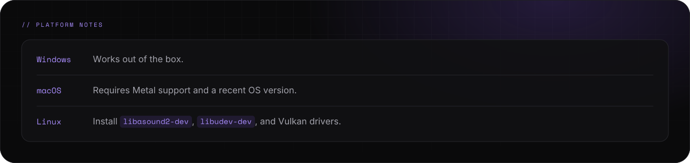
</picture>
</p>

<p>
<picture>
  <source media="(prefers-color-scheme: light)" srcset="assets/readme/tree-v2-light.svg">
  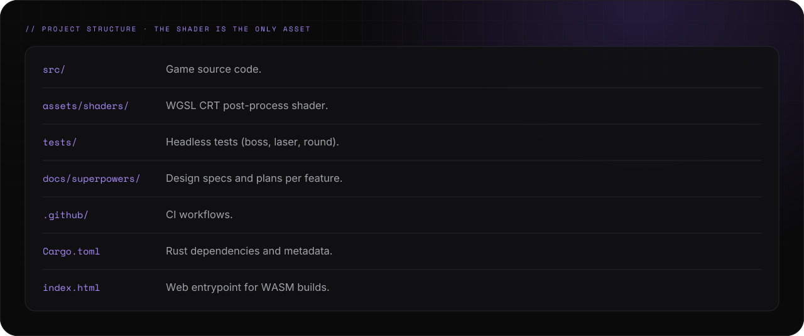
</picture>
</p>

<p>
<picture>
  <source media="(prefers-color-scheme: light)" srcset="assets/readme/learned-v2-light.svg">
  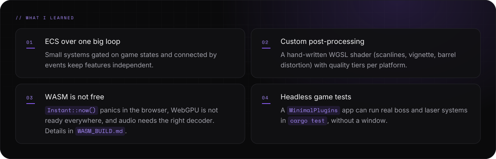
</picture>
</p>

<p>
<picture>
  <source media="(prefers-color-scheme: light)" srcset="assets/readme/contrib-v2-light.svg">
  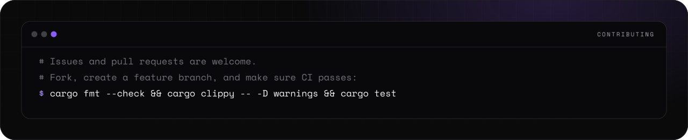
</picture>
</p>

<br>

<p>
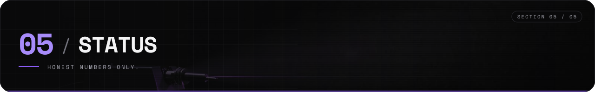
</p>

<p>
<picture>
  <source media="(prefers-color-scheme: light)" srcset="assets/readme/status-v2-light.svg">
  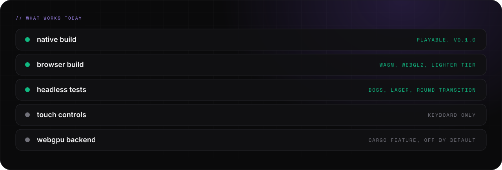
</picture>
</p>

<p>
<picture>
  <source media="(prefers-color-scheme: light)" srcset="assets/readme/state-v2-light.svg">
  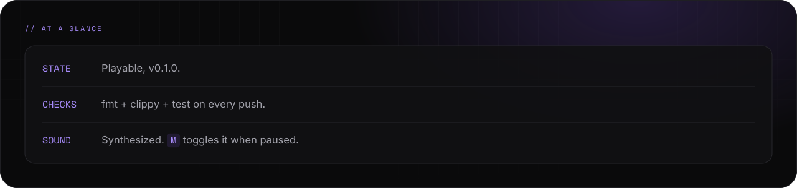
</picture>
</p>

<p>
<picture>
  <source media="(prefers-color-scheme: light)" srcset="assets/readme/ci-v2-light.svg">
  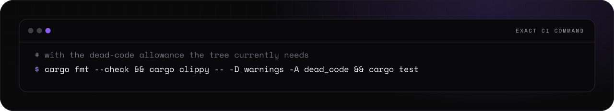
</picture>
</p>

<details>
<summary><picture><source media="(prefers-color-scheme: light)" srcset="assets/readme/links-7-v2-light.svg"></picture></summary>

```bash
cargo fmt --check && cargo clippy -- -D warnings && cargo test                # contributing
```

```bash
cargo fmt --check && cargo clippy -- -D warnings -A dead_code && cargo test   # exact CI command
```

```text
lab-arcade-shooter/
├── src/               # game source code
├── assets/shaders/    # WGSL CRT post-process shader
├── tests/             # headless tests (boss, laser, round)
├── docs/superpowers/  # design specs and plans per feature
├── .github/           # CI workflows
├── Cargo.toml         # Rust dependencies and metadata
└── index.html         # web entrypoint for WASM builds
```

</details>

<p>
<picture>
  <source media="(prefers-color-scheme: light)" srcset="assets/readme/cinotes-v2-light.svg">
  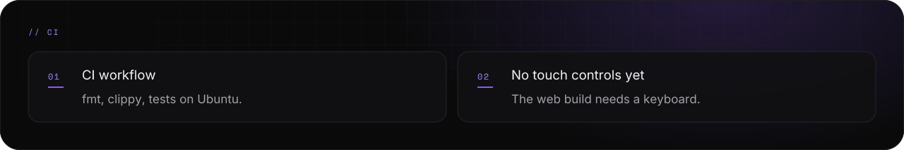
</picture>
</p>

<p align="center">
<a href="https://github.com/VelimirMueller/lab-arcade-shooter/actions/workflows/ci.yml"><picture><source media="(prefers-color-scheme: light)" srcset="assets/readme/links-4-v2-light.svg">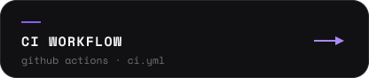</picture></a>
<a href="LICENSE"><picture><source media="(prefers-color-scheme: light)" srcset="assets/readme/links-5-v2-light.svg"></picture></a>
<a href="https://github.com/VelimirMueller"><picture><source media="(prefers-color-scheme: light)" srcset="assets/readme/links-6-v2-light.svg">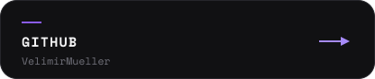</picture></a>
</p>

<p>
<picture>
  <source media="(prefers-color-scheme: light)" srcset="assets/readme/footer-v2-light.svg">
  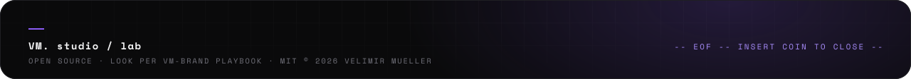
</picture>
</p>
