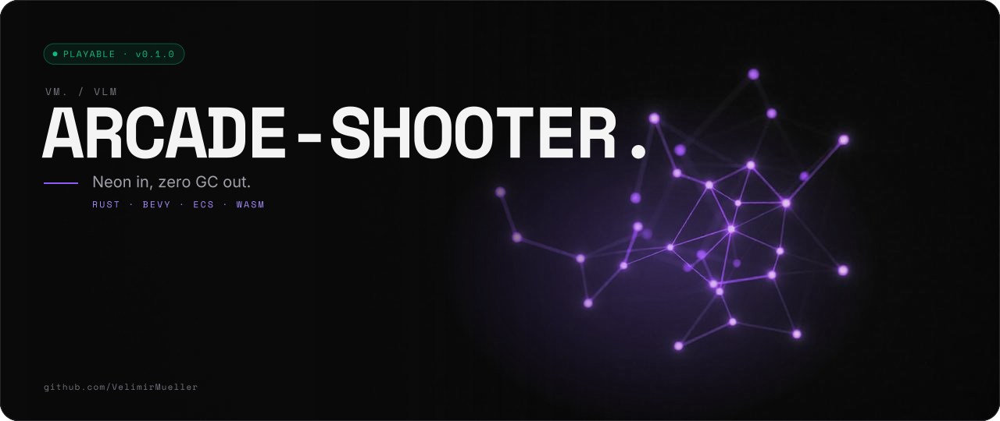

<picture>
  <source media="(prefers-color-scheme: light)" srcset="assets/banner/hero-v1-light.svg">
  
</picture>

   [](LICENSE)

> Neon in, zero GC out.

```text
 ████   █████    █████   ████   █████   ██████
██  ██  ██  ██  ██      ██  ██  ██  ██  ██
██████  █████   ██      ██████  ██  ██  █████   █████
██  ██  ██ ██   ██      ██  ██  ██  ██  ██
██  ██  ██  ██   █████  ██  ██  █████   ██████
 █████  ██  ██   ████    ████   ██████  ██████  █████
██      ██  ██  ██  ██  ██  ██    ██    ██      ██  ██
 ████   ██████  ██  ██  ██  ██    ██    █████   █████
    ██  ██  ██  ██  ██  ██  ██    ██    ██      ██ ██
█████   ██  ██   ████    ████     ██    ██████  ██  ██  ██
```

## // 01 WHAT IT DOES

- Is a neon-drenched, fast-paced, bloom-soaked geometry shooter: multi-stage boss battles, bullet hells and chaos in a neon-lit arena of pure arcade action.
- Is built with [Rust](https://www.rust-lang.org/) (2024 edition) and the [Bevy](https://bevyengine.org/) engine (0.16).
- Runs natively on Windows, macOS and Linux, and in the browser via WebAssembly.
- Is open source under the MIT License. [CI](https://github.com/VelimirMueller/cyberpunk_arcade_shooter/actions/workflows/ci.yml) checks format, lints and tests on every push and pull request to `main`.

*Step into a minimalist, glowing world where every shape pulses with danger.*

### Features

- **High-performance Rust + Bevy** — buttery-smooth gameplay powered by an ECS architecture
- **Bloom-soaked neon aesthetic** — every shape glows, every explosion radiates
- **Multi-stage boss fights** — evolving mechanics and unique attack patterns per phase
- **CRT post-processing** — scanlines, vignette, and barrel distortion for that retro feel
- **Tight arcade controls** — responsive movement and shooting that feels just right
- **WASM support** — runs in the browser via WebAssembly (keyboard required; there are no touch controls yet)

## // 02 QUICK START

### Prerequisites

- [Rust](https://www.rust-lang.org/tools/install) (latest stable, 2024 edition)
- A GPU with Vulkan, Metal, or DirectX 12 support

### Build & Run

```bash
git clone https://github.com/VelimirMueller/cyberpunk_arcade_shooter.git
cd cyberpunk_arcade_shooter
cargo run --release
```

### WASM (Browser)

The web build uses [Trunk](https://trunkrs.dev/):

```bash
rustup target add wasm32-unknown-unknown
cargo install trunk
trunk build --release   # output lands in dist/
trunk serve --release   # local dev server
```

In the browser the game picks a lighter quality tier (less bloom, flat CRT). See [WASM_BUILD.md](WASM_BUILD.md) for the browser-specific fixes and pitfalls.

### Platform Notes

| Platform | Notes |
| --- | --- |
| Windows | Works out of the box |
| macOS | Requires Metal support and a recent OS version |
| Linux | Install `libasound2-dev`, `libudev-dev`, and Vulkan drivers |

## // 03 HOW IT WORKS

```text
  keyboard  (WASD · Space · Esc)
     │
     ▼
  ┌──────────────────────┐  GameState: Menu ▸ RoundAnnounce ▸ RoundActive …
  │  Bevy App (ECS)      │
  │  small systems,      │──▸ player · boss phases · collision · powerups
  │  gated on GameState  │──▸ particles · screen shake · HUD
  └──────────┬───────────┘
             │  events: SoundEvent · DeathEvent
             ▼
  ┌──────────────────────┐        ┌───────────────────────────────┐
  │  audio (synthesized) │        │  render: shapes + bloom       │
  └──────────────────────┘        │  ▸ CRT WGSL post-process      │
                                  │    quality tier per platform  │
                                  └───────────────┬───────────────┘
                                                  ▼
                                    native window  ·  browser canvas
```

### Project Structure

```
cyberpunk_arcade_shooter/
├── src/               # Game source code
├── assets/shaders/    # WGSL CRT post-process shader (sprites are shapes, audio is synthesized)
├── tests/             # Headless integration tests (boss phases, laser, round transition)
├── docs/superpowers/  # Design specs and implementation plans per feature
├── .github/           # CI workflows
├── Cargo.toml         # Rust dependencies and metadata
└── index.html         # Web entrypoint for WASM builds
```

## // 04 USAGE

### Controls

| Action | Key |
| --- | --- |
| Start game | `Enter` |
| Move | `W` / `A` / `S` / `D` |
| Shoot | `Space` |
| Pause / resume | `Esc` |
| Toggle sound (paused) | `M` |
| Quit to menu (paused) | `Q` |

### What I Learned

- **ECS over one big loop** — small systems gated on game states and connected by events (`SoundEvent`, `DeathEvent`) keep features independent.
- **Custom post-processing** — a hand-written WGSL shader (scanlines, vignette, barrel distortion) with quality tiers per platform.
- **WASM is not free** — `Instant::now()` panics in the browser, WebGPU is not ready everywhere, and audio needs the right decoder. Details in [WASM_BUILD.md](WASM_BUILD.md).
- **Headless game tests** — a `MinimalPlugins` app can run real boss and laser systems in `cargo test`, without a window.

### Contributing

Contributions are welcome! Feel free to open an issue or submit a pull request.

1. Fork the repository
2. Create your feature branch (`git checkout -b feature/amazing-feature`)
3. Make sure CI passes (`cargo fmt --check && cargo clippy -- -D warnings && cargo test`)
4. Commit your changes (`git commit -m 'feat: add amazing feature'`)
5. Push to the branch (`git push origin feature/amazing-feature`)
6. Open a Pull Request

### License

Distributed under the MIT License. See [LICENSE](LICENSE) for details.

## // 05 STATUS

| | |
|---|---|
| 🟢 **Playable** | 0.1.0 |
| Tests | `cargo fmt --check && cargo clippy -- -D warnings -A dead_code && cargo test` |
| CI | [`ci.yml`](https://github.com/VelimirMueller/cyberpunk_arcade_shooter/actions/workflows/ci.yml) |

---

<sub>VM. studio / vlm · open source · look per <code>vm-brand</code> playbook</sub>
