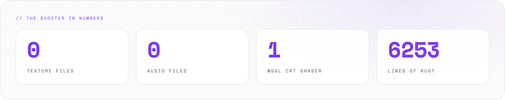
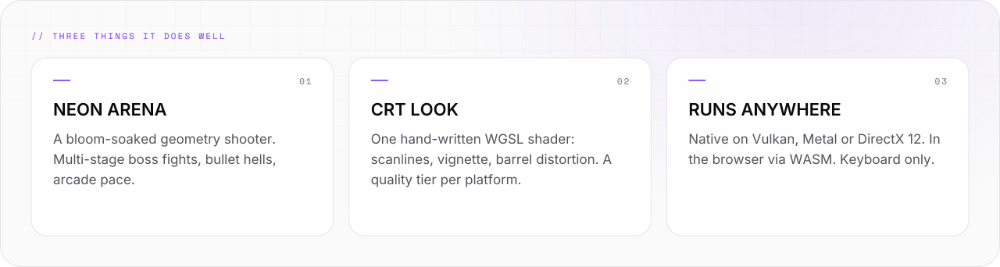
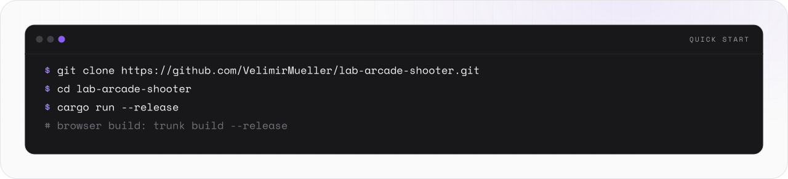
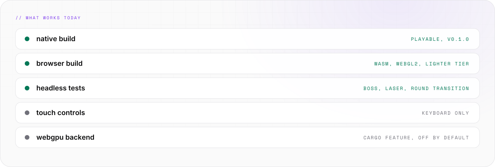

<picture>
  <source media="(prefers-color-scheme: light)" srcset="assets/banner/hero-v2-light.svg">
  
</picture>

<p align="center">

[](#-05-status) [](https://github.com/VelimirMueller) [](#-05-status) [](https://www.rust-lang.org/)

</p>

> Neon in, zero GC out.

```text
██       ████   █████           ████   █████    █████   ████   █████   ██████
██      ██  ██  ██  ██         ██  ██  ██  ██  ██      ██  ██  ██  ██  ██
██      ██████  █████   █████  ██████  █████   ██      ██████  ██  ██  █████
██      ██  ██  ██  ██         ██  ██  ██ ██   ██      ██  ██  ██  ██  ██
██████  ██  ██  █████          ██  ██  ██  ██   █████  ██  ██  █████   ██████
 █████  ██  ██   ████    ████   ██████  ██████  █████
██      ██  ██  ██  ██  ██  ██    ██    ██      ██  ██
 ████   ██████  ██  ██  ██  ██    ██    █████   █████
    ██  ██  ██  ██  ██  ██  ██    ██    ██      ██ ██
█████   ██  ██   ████    ████     ██    ██████  ██  ██
```

**lab-arcade-shooter** is a neon geometry shooter in [Rust](https://www.rust-lang.org/) (2024 edition) and [Bevy](https://bevyengine.org/) 0.16.
The shapes pulse. You shoot back.

<picture>
  <source media="(prefers-color-scheme: dark)" srcset="assets/readme/stats-v2-dark.svg">
  
</picture>

<br>

## // 01 WHAT IT DOES


<picture>
  <source media="(prefers-color-scheme: dark)" srcset="assets/readme/features-v2-dark.svg">
  
</picture>

- Fast arcade shooter: multi-stage boss fights and bullet hells in a neon arena.
- CRT look from one hand-written WGSL shader: scanlines, vignette, barrel distortion.
- Runs native on Windows, macOS and Linux, and in the browser via WebAssembly.
- Sprites are shapes. Audio is synthesized. No asset files ship with the game.
- Open source under the MIT License. [CI](https://github.com/VelimirMueller/lab-arcade-shooter/actions/workflows/ci.yml) checks format, lints and tests on every push and pull request to `main`.

<br>

## // 02 QUICK START


<picture>
  <source media="(prefers-color-scheme: dark)" srcset="assets/readme/start-v2-dark.svg">
  
</picture>

You need [Rust](https://www.rust-lang.org/tools/install) (latest stable, 2024 edition) and a GPU with Vulkan, Metal or DirectX 12 support.

```bash
git clone https://github.com/VelimirMueller/lab-arcade-shooter.git
cd lab-arcade-shooter
cargo run --release
```

### In the browser (WASM)

The web build uses [Trunk](https://trunkrs.dev/):

```bash
rustup target add wasm32-unknown-unknown
cargo install trunk
trunk build --release   # output lands in dist/
trunk serve --release   # local dev server
```

- The browser picks a lighter quality tier: less bloom, flat CRT.
- Keyboard required. There are no touch controls yet.
- See [WASM_BUILD.md](WASM_BUILD.md) for the browser-specific fixes and pitfalls.

<br>

## // 03 HOW IT WORKS


<picture>
  <source media="(prefers-color-scheme: dark)" srcset="assets/readme/flow-v2-dark.svg">
   BEVY ECS -> EVENTS -> RENDER. Sprites are shapes. Audio is synthesized. Nothing to load." src="assets/readme/flow-v2-light.svg" width="100%">
</picture>

```text
 keyboard (WASD · Space · Esc)
    │
    ▼
 ┌──────────────────┐   GameState: Menu ▸ RoundAnnounce ▸ RoundActive
 │  Bevy App (ECS)  │──▸ player · boss phases · collision · powerups
 │  small systems,  │──▸ particles · screen shake · HUD
 │  gated on state  │
 └────────┬─────────┘   events: SoundEvent · DeathEvent
          ▼
 ┌────────────────┐     ┌──────────────────────────┐
 │ audio (synth)  │     │ render: shapes + bloom   │
 └────────────────┘     │ ▸ CRT WGSL post-process  │
                        │   quality tier per plat. │
                        └────────────┬─────────────┘
                                     ▼
                       native window · browser canvas
```

- Small systems, gated on `GameState`. One system does one thing.
- Systems talk through events (`SoundEvent`, `DeathEvent`). Features stay independent.
- The renderer draws shapes with bloom. The CRT shader runs last, at a quality tier per platform.
- The same code builds native and WASM. Only the quality tier changes.

<br>

## // 04 USAGE


### Controls

- Start game: `Enter`
- Move: `W` / `A` / `S` / `D`
- Shoot: `Space`
- Pause / resume: `Esc`
- Toggle sound (paused): `M`
- Quit to menu (paused): `Q`

### Platform notes

- **Windows** — works out of the box.
- **macOS** — requires Metal support and a recent OS version.
- **Linux** — install `libasound2-dev`, `libudev-dev`, and Vulkan drivers.

### Project structure

```text
lab-arcade-shooter/
├── src/               # game source code
├── assets/shaders/    # WGSL CRT post-process shader
├── tests/             # headless tests (boss, laser, round)
├── docs/superpowers/  # design specs and plans per feature
├── .github/           # CI workflows
├── Cargo.toml         # Rust dependencies and metadata
└── index.html         # web entrypoint for WASM builds
```

- Sprites are shapes. Audio is synthesized. The shader is the only asset.

### What I learned

- **ECS over one big loop** — small systems gated on game states and connected by events keep features independent.
- **Custom post-processing** — a hand-written WGSL shader (scanlines, vignette, barrel distortion) with quality tiers per platform.
- **WASM is not free** — `Instant::now()` panics in the browser, WebGPU is not ready everywhere, and audio needs the right decoder. Details in [WASM_BUILD.md](WASM_BUILD.md).
- **Headless game tests** — a `MinimalPlugins` app can run real boss and laser systems in `cargo test`, without a window.

### Contributing

Issues and pull requests are welcome. Fork, create a feature branch, and make sure CI passes:

```bash
cargo fmt --check && cargo clippy -- -D warnings && cargo test
```

<br>

## // 05 STATUS


<picture>
  <source media="(prefers-color-scheme: dark)" srcset="assets/readme/status-v2-dark.svg">
  
</picture>

```text
[ STATE  ]  playable, v0.1.0
[ CHECKS ]  fmt + clippy + test on every push
[ SOUND  ]  synthesized; M toggles it when paused
```

The exact CI command, with the dead-code allowance the tree currently needs:

```bash
cargo fmt --check && cargo clippy -- -D warnings -A dead_code && cargo test
```

- [CI workflow](https://github.com/VelimirMueller/lab-arcade-shooter/actions/workflows/ci.yml): fmt, clippy, tests on Ubuntu.
- No touch controls yet. The web build needs a keyboard.

<br>

```text
-- EOF --------------------------------------------- INSERT COIN TO CLOSE --
```

---

<sub>VM. studio / lab · open source · look per <code>vm-brand</code> playbook · [MIT](LICENSE) © 2026 Velimir Mueller</sub>
